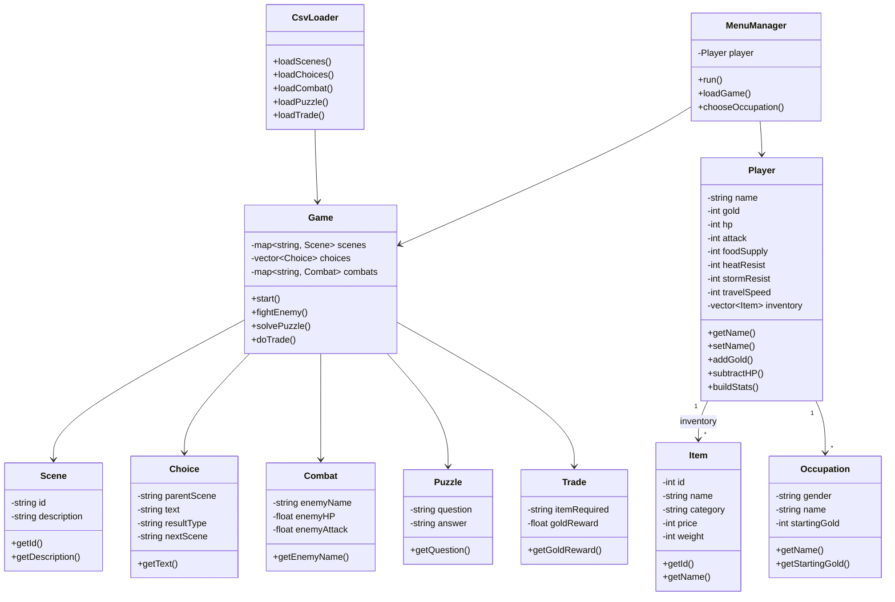

------------------------------------------------------------------------------------

### Golden Dunes Trail

Golden Dunes is a text based adventure set in a fictional desert where the player must prepare for and survive a challenging journey. The game combines exploration, decision making and resource management, with the player's choices affecting how the journey progresses. The player can choose an occupation and purchase items such as food, clothing, weapons and animals before setting off. During the journey, they encounter different scenes, enemies, puzzles and trading opportunities while managing their health, food, gold and other statistics. The game contains 32 story scenes with branching paths and different outcomes. It also includes combat, inventory management, environmental effects and save/load functionality, with much of the game content stored in external CSV files.

-------------------------------------

### Table of Contents

-----------------------------------------

1. [Introduction](#introduction)

2. [Analysis and Design](#analysis-and-design) 

3. [Input Process Output Table](#input-process-output-table)

4. [Algorithms](#algorithms)
   
   4.1 [Game Start Algorithm](#game-start-algorithm)
   
   4.2 [Scene Algorithm](#scene-algorithm)
   
   4.3 [Environmental Drain Algorithm](#environmental-drain-algorithm)
   
   4.4 [Combat Algorithm](#combat-algorithm)
   
   4.5 [Puzzle Algorithm](#puzzle-algorithm)
   
   4.6 [Trade Algorithm](#trade-algorithm)
   
   4.7 [Save Game Algorithm](#save-game-algorithm)
   
   4.8 [Load Game Algorithm](#load-game-algorithm)
   
   4.9 [Build Stats Algorithm](#build-stats-algorithm)

5. [Class Diagram](#class-diagram)

6. [Testing](#testing)

7. [Technical Elements](#technical-elements)

8. [Object-Oriented Design](#object-oriented-design)

9. [Data Structures](#data-structures)

10. [File Handling](#file-handling)

11. [Input Validation](#input-validation)

12. [Evaluation](#evaluation)
    
    12.1 [Does it meet the program requirements?](#does-it-meet-the-program-requirements?)
    
    12.2 [Strengths of the program](#strengths-of-the-program)
    
    12.3 [Weaknesses of the program](#weaknesses-of-the-program)
    
    12.4 [Areas where it could be improved](#areas-where-it-could-be-improved)
    
    12.5 [Lessons learnt](#lessons-learnt)

13. [References](#references)

14. [Citation](#citation)

------------------------------------

### Introduction

--------

The purpose of this program is to develop a text - based adventure game. The project aims to demonstrate proficiency in Object - Oriented Programming (OOP) principles, with error handling and program design techniques in order to build an interactive game system. The game allows the player to explore a fictional desert world called Golden Dunes, where the player travels through different scenarios, solves puzzles, fights enemies, and makes choices that influence the story.

Text - based adventure games rely entirely on written descriptions and user input rather than graphics. The player interacts with the game by selecting choices that determine the direction of the story. Each decision leads to different outcomes such as combat encounters, puzzles, or trading opportunities. The game also demonstrates good programming practices including modular class design, error handling, and data - driven design using external CSV files.

----------------------------

### Analysis and Design

------------------------------------

The goal of the program is to create an interactive adventure game where players travel across a desert environment and make decisions that influence their survival and progress.

The main features of the program include:

- A main menu allowing the player to start a new game, load a saved game, view instructions, view credits, or exit. 

- Player setup: name entry, gender and occupation selection, and a shopping phase to purchase food, clothing, weapons, and animals before departure.

- 32 unique story scenes loaded from Scenarios.csv, connected by branching binary choices loaded from Choice.csv.

- Combat encounters with enemies using a round-based damage system driven by Combat.csv.

- Puzzle challenges that require the player to answer text questions loaded from Puzzle.csv.

- Trade events that resolve automatically when the player selects that path, driven by Trade.csv.

- A Caravan Status display showing HP(Health Points), food days remaining, gold, attack power, heat resistance, and storm resistance.

- Environmental drain: heat scenes reduce Health Points without sufficient clothing; storm scenes reduce Health Points without storm resistance.Food depletes every scene and hunger reduces Health Points when exhausted.

- Save and load system using savegame.csv to persist player state between sessions.
  Credits loaded from an external credits.csv file.

The game progresses by loading different scenes from external CSV files and presenting choices to the player until the story reaches an ending. Victory is reached at scene S31 the Gates of Aurion. Scene S32 provides an alternative ending.

----------------------------------------------------------------------------

### Input Process Output Table

--------------------------------------------------------------------------------------

The table below describes the key inputs the program receives, the processes that handle each input, and the outputs produced.

| **Input**                                                                | **Process**                                                                                                                       | **Output**                                                                             |
| ------------------------------------------------------------------------ | --------------------------------------------------------------------------------------------------------------------------------- | -------------------------------------------------------------------------------------- |
| Player enters name at game start                                         | MenuManager stores name using player.setName() inside Player class                                                                | Player name displayed in Caravan Status box throughout the journey                     |
| CSV files (Scenarios.csv, Choice.csv, Combat.csv, Puzzle.csv, Trade.csv) | CsvLoader class uses ifstream and stringstream to parse each file into scenes, choices, combats, puzzles, and trades maps/vectors | Game scenes, choices, puzzles, enemies, and trades become available for the journey    |
| Player selects menu option (1 - 5)                                       | mainMenu() inside MenuManager reads integer input and routes to the matching method                                               | Game starts, saved game loads, instructions shown, credits displayed, or program exits |
| Player selects a story choice (1, 2, or S to save)                       | resolveChoice() in Game class checks resultType and calls fightEnemy(), solvePuzzle(), or doTrade() accordingly                   | Game progresses to next scene, triggers combat, puzzle, or trade event                 |
| Combat encounter triggered                                               | fightEnemy() runs a round loop subtracting player attack from enemy HP and enemy attack from player HP each round                 | Enemy defeated, player damaged, or player survives with 1 HP and moves to lose scene   |
| Puzzle answer entered by player                                          | solvePuzzle() trims and lowercases both the player answer and correct answer then compares them                                   | Correct answer moves to success scene; wrong answer sends to alternate scene           |
| Trade path chosen by player                                              | doTrade() applies gold reward, prints item narrative, and returns nextAccept scene automatically                                  | Gold updated, narrative shown, player advances to next scene                           |
| Player presses S to save                                                 | saveGame() in Game class writes all Player stats and inventory item IDs to savegame.csv using ofstream                            | Save file created; player continues from the same scene                                |
| Player selects Load Game from menu                                       | loadGame() in MenuManager reads savegame.csv line by line restoring all Player fields and inventory                               | Previous game state restored; journey resumes from saved scene                         |
| Player selects How To Play                                               | MenuManager prints instruction text to console                                                                                    | Instructions displayed; menu re-appears                                                |
| Player HP drops to zero or below                                         | Game::start() detects p.getHP() <= 0 after applySceneDrain() or combat and breaks the journey loop                                | Game Over screen displayed with final gold total                                       |

---------------------------------

### Algorithms

-----------------------------------------------------------------------------

The following pseudocode algorithms describe the core logic of the program. The notation follows the OOP pseudocode guide: classes are defined using CLASS, attributes use PRIVATE/PUBLIC, constructors use CONSTRUCTOR, and methods use METHOD/END METHOD.

#### **Game Start Algorithm**

*(MenuManager::run)*

This algorithm initialises the game, loads all CSV data, displays the main menu, and routes the player to the correct function based on their choice.

```textile
START

  CALL loadAllData()
    CALL CsvLoader.loadItems("inventory.csv", player.shopItems)
    CALL CsvLoader.loadOccupations("occupations.csv", player.occupations)
    CALL CsvLoader.loadStory("story.csv", player.stories)

  WHILE true DO
    PRINT main menu options (Play, Load Game, How To Play, Credits, Exit)
    READ userChoice

    IF userChoice IS 1 THEN
      CALL player.reset()
      READ playerName
      CALL player.setName(playerName)
      CALL showStory("MENU")
      CALL chooseGender()
      CALL chooseOccupation(gender)
      CALL buyItem("Food")
      CALL buyItem("Clothing")
      CALL buyItem("Weapon")
      CALL buyItem("Animal")
      CALL showInventory()
      CREATE game AS NEW Game
      CALL game.start(player, buildStatsFirst=true)

    ELSE IF userChoice IS 2 THEN
      CALL loadGame()
      IF resumeScene IS NOT empty THEN
        CREATE game AS NEW Game
        CALL game.setStartScene(resumeScene)
        CALL game.start(player, buildStatsFirst=false)
      END IF

    ELSE IF userChoice IS 3 THEN
      PRINT instructions text

    ELSE IF userChoice IS 4 THEN
      CALL showCredits()

    ELSE IF userChoice IS 5 THEN
      EXIT program
    END IF

  END WHILE

END
```

#### **Scene Algorithm**

*(Game::start)*

This algorithm controls how the player progresses through the story. It displays each scene, applies environmental drain, and presents choices. The player can press S to save at any point.

```textile
START

  IF buildStatsFirst IS true THEN
    CALL player.buildStats()
  END IF

  PRINT "THE JOURNEY BEGINS"
  CALL showJourneyStatus(player)

  WHILE true DO

    CALL applySceneDrain(player)
    PRINT scene description from scenes map

    IF player.getHP() <= 0 THEN
      PRINT "Your Caravan Has Fallen"
      END journey
    END IF

    IF current_scene IS "S31" OR "S32" THEN
      PRINT ending message with final gold and HP
      END journey
    END IF

    GET sceneChoices FOR current_scene
    FOR EACH choice IN sceneChoices
      PRINT choice number and text
    END FOR
    PRINT "S. Save game"

    READ playerInput

    IF playerInput IS "S" THEN
      CALL saveGame(player)
      CONTINUE loop
    END IF

    IF playerInput IS valid choice number THEN
      CALL resolveChoice(selectedChoice, player)
      SET current_scene TO returned nextScene
      CALL showJourneyStatus(player)
    ELSE
      PRINT "Invalid. Try again"
    END IF

  END WHILE

END
```

#### **Environmental Drain Algorithm**

*(Game::applySceneDrain)*

This algorithm is called every time the player enters a new scene. It reduces food supply and applies HP penalties for heat and storm scenes based on the player's clothing stats.

```textile
START

  SET foodDrain TO max(1, 3 - player.getTravelSpeed() + 1)

  IF current_scene IS a heat scene THEN
    SET hpLoss TO max(0, 8 - player.getHeatResist() / 5)
    IF hpLoss > 0 THEN
      CALL player.subtractHP(hpLoss)
      PRINT heat warning
    END IF
  END IF

  IF current_scene IS a storm scene THEN
    SET hpLoss TO max(0, 6 - player.getStormResist() / 5)
    IF hpLoss > 0 THEN
      CALL player.subtractHP(hpLoss)
      PRINT storm warning
    END IF
  END IF

  CALL player.subtractFood(foodDrain)

  IF player.getFoodSupply() IS 0 THEN
    CALL player.subtractHP(5)
    PRINT hunger warning
  END IF

END
```

#### **Combat Algorithm**

*(Game::fightEnemy)*

This algorithm manages battles between the player and enemies. The player attacks the enemy each round, reducing its health. The enemy then attacks the player. If the enemy's health reaches zero the player wins and receives gold. If the player's health reaches zero, they survive with 1 HP and the game moves to the lose scene.

```textile
START

  SET eHP TO enemy.getEnemyHP()
  SET pHP TO player.getHP()
  SET pAtk TO player.getAttack()
  SET eAtk TO enemy.getEnemyAttack()

  PRINT enemy name, enemy HP, player HP, player attack

  WHILE eHP > 0 AND pHP > 0 DO
    SET eHP TO eHP - pAtk
    PRINT damage dealt and remaining enemy HP

    IF eHP <= 0 THEN
      BREAK
    END IF

    SET pHP TO pHP - eAtk
    PRINT damage taken and remaining player HP
  END WHILE

  IF pHP <= 0 THEN
    CALL player.setHP(1)
    PRINT "You are badly wounded but survive"
    RETURN enemy.getNextLose()
  ELSE
    CALL player.setHP(pHP)
    SET reward TO eAtk * 3
    CALL player.addGold(reward)
    PRINT "Enemy defeated" and gold found
    RETURN enemy.getNextWin()
  END IF

END
```

#### **Puzzle Algorithm**

*(Game::solvePuzzle)*

This algorithm presents a puzzle question to the player and waits for an answer. The program trims whitespace and compares answers case insensitively. If correct, the player moves to the success scene; if wrong, to the alternate scene.

```textile
START

  PRINT puzzle.getQuestion()
  READ playerAnswer
  TRIM whitespace from playerAnswer
  CONVERT playerAnswer TO lowercase
  CONVERT puzzle.getAnswer() TO lowercase

  IF playerAnswer IS equal to puzzle.getAnswer() THEN
    PRINT "Correct! The ancient mechanism yields..."
    RETURN puzzle.getNextCorrect()
  ELSE
    PRINT "Wrong. The answer was: " + puzzle.getAnswer()
    RETURN puzzle.getNextWrong()
  END IF

END
```

#### **Trade Algorithm**

*(Game::doTrade)*

This algorithm resolves a trade event. Choosing a trade path is itself the decision - no y/n prompt is needed. The program prints narrative text, applies any gold reward, and moves the player to the accept scene.

```textile
START

  IF trade.getItemRequired() IS NOT empty THEN
    PRINT "You offer your " + trade.getItemRequired()
  END IF

  IF trade.getGoldReward() > 0 THEN
    CALL player.addGold(trade.getGoldReward())
    PRINT "You receive " + gold + " gold"
  END IF

  IF trade.getItemGiven() IS NOT empty THEN
    PRINT "You receive: " + trade.getItemGiven()
  END IF

  RETURN trade.getNextAccept()

END
```

#### **Save Game Algorithm**

*(Game::saveGame)*

This algorithm saves the current game progress to savegame.csv. It writes all player statistics, the current scene, and the ID of each inventory item so the player can continue the game later.

```textile
START

  OPEN savegame.csv FOR writing using ofstream
  IF file cannot open THEN
    PRINT "Save failed"
    RETURN
  END IF

  WRITE "field,value" header row
  WRITE playerName, scene, gold, playerHP
  WRITE playerAttack, heatResist, stormResist
  WRITE travelSpeed, foodSupply, currentWeight

  FOR EACH item IN player.getInventory() DO
    WRITE "inventory," + item.getId()
  END FOR

  CLOSE file
  PRINT "[Game saved.]"

END
```

#### **Load Game Algorithm**

*(MenuManager::loadGame)*

This algorithm loads previously saved game data. The program reads savegame.csv and restores the Player's statistics, inventory items, and the scene where the game was last saved.

```textile
START

  OPEN savegame.csv FOR reading using ifstream
  IF file does not exist THEN
    PRINT "No save file found"
    RETURN empty string
  END IF

  CALL player.reset()
  SKIP header line

  WHILE there are lines in file DO
    READ field and value from each line
    MATCH field name AND CALL matching player setter
    IF field IS "inventory" THEN
      FIND item in shopItems with matching ID
      CALL player.addToInventory(item)
    END IF
  END WHILE

  IF resumeScene IS empty THEN
    PRINT "Save file is corrupted"
    RETURN empty string
  END IF

  PRINT "Game loaded. Welcome back, " + player.getName()
  RETURN resumeScene

END
```

#### **Build Stats Algorithm**

*(Player::buildStats)*

This algorithm calculates the player's journey statistics from the items purchased in the shopping phase. It is called once at the start of a new game.

```textile
START

  SET hp TO 100
  SET attack TO 5
  SET heatResist TO 0
  SET stormResist TO 0
  SET travelSpeed TO 1
  SET foodSupply TO 0

  FOR EACH item IN inventory DO

    IF item.getCategory() IS "Food" THEN
      ADD food days based on item ID (6 to 10 days) TO foodSupply
    END IF

    IF item.getCategory() IS "Clothing" THEN
      ADD 10 TO heatResist
      ADD 10 TO stormResist
    END IF

    IF item.getCategory() IS "Weapon" THEN
      SET attack based on weapon ID (10 to 25)
    END IF

    IF item.getCategory() IS "Animal" THEN
      SET travelSpeed based on animal ID (1 to 4)
    END IF

  END FOR

END
```

----------------------------------------------

### Class Diagram

-------------------------------------------



------------------------------------------------------------------------------------

### Testing

-------------------------------------------------------------------------------------------

Black box testing checks whether the system behaves correctly based on user input, without examining the internal code structure. Each feature was tested with four test cases covering valid inputs, invalid inputs, edge cases, and boundary conditions. The note at the top of the test table from the tutor states that each instance of input should have four test cases. This has been applied across all eleven features tested.

| **No.** | **Feature**        | **Input**                                                                       | **Expected Output**                                                | **Actual Output**                                         | **Actions/Comments**             |
| ------- | ------------------ | ------------------------------------------------------------------------------- | ------------------------------------------------------------------ | --------------------------------------------------------- | -------------------------------- |
| 1       | Start Game         | Select menu option 1, enter name 'Deborah'                                      | Game asks for name, shows story, proceeds to gender selection      | Game asked for name, displayed story text and gender menu | No action required. Test passed. |
| 2       | Start Game         | Select menu option 1 and press Enter without typing a name                      | Name defaults to Traveller, game continues normally                | Name stored as Traveller, game proceeded without crash    | No action required. Test passed. |
| 3       | Start Game         | Select menu option 1 then choose occupation 0 (Go Back)                         | Game returns to gender selection                                   | Gender selection reappeared correctly                     | No action required. Test passed. |
| 4       | Start Game         | Complete full setup and reach journey scene S1                                  | Journey begins from scene S1 with correct caravan status           | Journey started at S1 with correct HP, food, attack, gold | No action required. Test passed. |
| 5       | Load Game          | Select menu option 2 with an existing savegame.csv                              | Saved game loads, player stats and scene restored, journey resumes | All stats and scene restored correctly, journey resumed   | No action required. Test passed. |
| 6       | Load Game          | Select menu option 2 with no savegame.csv present                               | Message: No save file found, returns to menu                       | Message displayed, menu reappeared without crash          | No action required. Test passed. |
| 7       | Load Game          | Select menu option 2 with an empty savegame.csv                                 | Message: Save file corrupted, returns to menu                      | Corrupted message shown, no crash                         | No action required. Test passed. |
| 8       | Load Game          | Load a save at scene S9 with HP 45                                              | Journey resumes at S9 with HP 45 shown in status box               | HP 45 and scene S9 displayed correctly                    | No action required. Test passed. |
| 9       | Invalid Menu Input | Enter a letter e.g. x at the main menu                                          | Program re - prompts without crashing                              | Re - prompt shown, no crash                               | No action required. Test passed. |
| 10      | Invalid Menu Input | Enter 0 at the main menu                                                        | No action, menu re - prompts                                       | Menu re - appeared cleanly                                | No action required. Test passed. |
| 11      | Invalid Menu Input | Enter 9 (out of range) at the main menu                                         | No action, menu re - prompts                                       | Menu re - appeared cleanly                                | No action required. Test passed. |
| 12      | Invalid Menu Input | Enter a decimal e.g. 1.5 at the main menu                                       | Program ignores decimal and re - prompts                           | Re - prompt shown correctly                               | No action required. Test passed. |
| 13      | Scene Choice       | Enter choice 1 at scene S1                                                      | Game moves to S2 Burning Noon                                      | Scene S2 loaded and displayed                             | No action required. Test passed. |
| 14      | Scene Choice       | Enter choice 2 at scene S1                                                      | Game moves to S3 Rolling Sandstorm                                 | Scene S3 loaded and displayed                             | No action required. Test passed. |
| 15      | Scene Choice       | Enter S at any scene choice prompt                                              | savegame.csv is written, same choices reappear                     | Save file written, same choices shown on next prompt      | No action required. Test passed. |
| 16      | Scene Choice       | Enter 0 (invalid) at scene choice                                               | Program re - prompts without moving scene                          | Re - prompt shown, scene unchanged                        | No action required. Test passed. |
| 17      | Combat             | Choose combat option with Flintlock Pistol (attack 15) vs Bandit Raider (HP 25) | Enemy defeated in 2 rounds, player receives 15 gold                | Bandit Raider defeated in 2 rounds, gold received         | No action required. Test passed. |
| 18      | Combat             | Choose combat option with no weapon (base attack 5) vs Bandit Captain (HP 40)   | More rounds needed, player takes heavy damage                      | 8 rounds played, player HP reduced heavily                | No action required. Test passed. |
| 19      | Combat             | Player HP reaches 0 during combat                                               | Player survives with 1 HP and moves to the lose scene              | HP set to 1, nextLose scene loaded                        | No action required. Test passed. |
| 20      | Combat             | Win a combat encounter                                                          | Gold reward applied and win scene loads                            | Gold updated, win scene displayed                         | No action required. Test passed. |
| 21      | Puzzle             | Enter correct answer 'east' for milestone puzzle P1                             | Message: Correct. Game moves to S9                                 | Correct message shown, S9 loaded                          | No action required. Test passed. |
| 22      | Puzzle             | Enter wrong answer 'west' for P1                                                | Message: Wrong. The answer was: east. Game moves to S6             | Wrong message shown with correct answer, S6 loaded        | No action required. Test passed. |
| 23      | Puzzle             | Enter correct answer in capitals e.g. 'EAST'                                    | Treated as correct due to case - insensitive compare               | Correct, scene S9 loaded                                  | No action required. Test passed. |
| 24      | Puzzle             | Enter blank answer (spaces only)                                                | Treated as wrong after trimming, moves to wrong scene              | Wrong scene loaded, no crash                              | No action required. Test passed. |
| 25      | Trade              | Choose trade path T1 (nomads, 60 gold reward)                                   | Trade narrative shown, gold increases by 60, moves to S27          | Gold increased by 60, S27 loaded                          | No action required. Test passed. |
| 26      | Trade              | Choose trade path T3 (jackal statue, 0 gold)                                    | Trade narrative shown with item given, moves to S25                | S25 loaded, no gold change displayed                      | No action required. Test passed. |
| 27      | Trade              | Choose trade path T4 (prospector, 0 gold)                                       | Item received narrative shown, moves to S31 victory                | S31 loaded, narrative displayed                           | No action required. Test passed. |
| 28      | Trade              | Buy no items before journey and trigger a trade                                 | Trade resolves with no item shown, game continues                  | No crash, scene advanced normally                         | No action required. Test passed. |
| 29      | Save Game          | Press S during journey scene                                                    | savegame.csv created with current scene, stats, inventory IDs      | File created with correct data                            | No action required. Test passed. |
| 30      | Save Game          | Press S twice during the same journey                                           | Second save overwrites the first                                   | Latest state written, no duplicate                        | No action required. Test passed. |
| 31      | Save Game          | Save with empty inventory (skipped all shops)                                   | savegame.csv contains no inventory lines                           | File written correctly with no inventory rows             | No action required. Test passed. |
| 32      | Save Game          | Save at S15 then load back                                                      | Scene S15 and all stats restored correctly                         | Exact state restored, journey resumed at S15              | No action required. Test passed. |
| 33      | Load Saved Game    | Load a save where HP is 5                                                       | HP 5 shown in caravan status box on load                           | Status box showed HP 5 correctly                          | No action required. Test passed. |
| 34      | Load Saved Game    | Load a save with Repeating Rifle in inventory (attack 25)                       | Attack restored to 25                                              | Status box showed attack 25                               | No action required. Test passed. |
| 35      | Load Saved Game    | Load a save at scene S20                                                        | Journey starts from S20 Bandit Secrets                             | S20 description and choices shown                         | No action required. Test passed. |
| 36      | Load Saved Game    | Load when scene field is missing in savegame.csv                                | Corrupted save message shown, returns to menu                      | Corrupted message displayed                               | No action required. Test passed. |
| 37      | Inventory Display  | Complete all four shops and view supplies                                       | All purchased items listed with category and name, gold shown      | Items and gold displayed correctly                        | No action required. Test passed. |
| 38      | Inventory Display  | Skip all shop categories and view supplies                                      | Gold shown with no item lines                                      | Gold shown, no items listed                               | No action required. Test passed. |
| 39      | Inventory Display  | Buy one food item (Sun - Dried Lizard Jerky) and check food days                | 10 days shown in caravan status at journey start                   | 10 days displayed correctly                               | No action required. Test passed. |
| 40      | Inventory Display  | Buy Flatbread Rations and check food days                                       | 7 days shown in caravan status at journey start                    | 7 days displayed correctly                                | No action required. Test passed. |
| 41      | Game Over          | Player HP reaches 0 from hunger and heat combined                               | Game Over screen with final gold shown                             | Game Over displayed, gold correct                         | No action required. Test passed. |
| 42      | Game Over          | Player HP reaches 0 in combat (lose path)                                       | Player survives with 1 HP, moves to lose scene                     | HP set to 1, lose scene loaded                            | No action required. Test passed. |
| 43      | Game Over          | Reach S31 Gates of Aurion                                                       | Victory screen with final gold and HP shown                        | Victory displayed, stats correct                          | No action required. Test passed. |
| 44      | Game Over          | Reach S32 Journey's End alternative ending                                      | Ending screen with Journey Has Ended message shown                 | S32 message and stats displayed                           | No action required. Test passed. |

------------------------------------------------------------------------------------------------------------------------------

### Technical Elements

--------------------------------------------------

<u>**Programming Language**</u>: The program was developed using the C++17 standard, which supports object-oriented programming and efficient memory management.

---------------------------------------------

### Object - Oriented Design

--------------------------------------

The system uses ten classes to organise the program into logical, encapsulated components. Every class has private member variables accessed only through public getter and setter methods, which satisfies the OOP principle of encapsulation.

- <u>Item Class</u> - Represents purchasable items. Private members store id, name, category, price, weight, description, and effect. Seven public getter methods provide controlled read - only access.

- <u>Occupation Class</u> - Stores gender, name, starting gold, and description. Public getters expose each field.

- <u>Story Class</u> - Holds pre-game narrative text indexed by stage name. Getters allow the display method to retrieve the correct story block.

- <u>Scene Class</u> - Represents a story scene with private id and description. Private members are accessed via getId() and getDescription().

- <u>Choice Class</u> - Stores parent scene, choice text, result type, result ID, and next scene ID. All five fields are private with public getters.

- <u>Combat Class</u> - Stores enemy name, HP, and attack values with win and lose scene targets. Private fields are accessed through getters and modified through setters where required by CsvLoader.

- <u>Puzzle Class</u> - Stores question, answer, and outcome scenes. Private fields are accessed via getters and set via setters during CSV loading.

- <u>Trade Class</u> - Stores item required, gold reward, item given, and outcome scenes. Private fields with getters and setters.

- <u>Player Class</u> - Consolidates all player state that was previously in global variables: name, gold, HP, attack, resistances, travel speed, food supply, carry weight, inventory, shop items, occupations, and stories. All fields are private with public getters, setters, and mutator methods such as addGold(), subtractHP(), and buildStats().

- <u>CsvLoader Class</u> - Contains static methods to load each CSV file type into the appropriate data structure. Separating file-loading logic keeps the Game and MenuManager classes smaller and more focused.

- <u>Game Class</u> - Controls the journey loop including scene navigation, combat, puzzles, trades, environmental drain, status display, and saving. All data structures and helper methods are private.

- <u>MenuManager Class</u> - Controls the main menu, shopping phase, gender and occupation selection, story display, credits, and load game. Owns a single Player instance that carries state through the entire program.

-----------------------------------------------------

### Data Structures

----------------------------------------------

<u>**Vector**</u>

The std::vector container is used to store the player inventory, shop items, choices, occupations, and stories. Vectors are dynamic arrays that automatically grow when new elements are added using push_back(). They are used wherever the number of elements is not known at compile time.

**<u>Map</u>**

The std::map container is used inside the Game class to store scenes, combats, puzzles, and trades, each keyed by their string ID from the CSV files. Maps store key - value pairs in sorted order and provide O(log n) lookup by key. The game uses map.find() and map.count() to safely check whether a key exists before accessing it.

---------------------------------------------------------

### File Handling

-------------------------------------

**<u>CSV Data Loading</u>**

The game reads all story elements from external CSV files using ifstream. The CsvLoader class uses getline() with a comma delimiter and stringstream to split each row into fields and construct the relevant class object. This data - driven approach means story content, puzzles, enemies, and trades can be modified without changing any program code.

**<u>Save and Load System</u>**

Game progress is stored in savegame.csv using ofstream in a key - value format. The program writes the player name, HP, gold, attack, resistances, travel speed, food supply, current weight, current scene, and the ID of each inventory item. On loading, ifstream reads each field back and calls the matching Player setter method. Inventory is restored by matching saved IDs against the shop items vector.

**<u>Credits File</u>**

The credits screen reads from credits.csv using ifstream. Each row contains a role and a name, which are printed in a formatted table. Keeping credits in a separate file means they can be updated without recompiling the program.

**<u>Input Validation</u>**

All menu and choice inputs use cin >> with try - catch(...) blocks wrapping stoi() conversions to handle non - numeric input safely. If a string cannot be converted to an integer, the exception is caught silently and the player is re - prompted. CSV loading uses try - catch to skip malformed rows without crashing. Puzzle answers are trimmed of leading and trailing whitespace and compared case insensitively, preventing minor typing differences from causing incorrect results.

-----------------------------------------------

### Evaluation

--------------------------------------------------

#### **<u>Does it meet the program requirements?</u>**

The text - based OOP adventure game I developed meets the main requirements of the task. The program allows a player to explore a fictional desert world through branching story scenes and uses object - oriented programming to structure the solution into appropriate classes such as Player, Game, MenuManager, CsvLoader, Item, Combat, Puzzle, Trade, Scene, and Choice.

I successfully implemented all 32 story scenes connected by branching binary choices, which meets the requirement for a data-driven narrative system. I also included three distinct interaction types; combat, puzzles, and trades, which improves the depth of gameplay and demonstrates a wider range of programming techniques. The program also maintains a save and load system using savegame.csv that persists player state between sessions, meeting the requirement for data storage.

However, there are some requirements that were only partially met. While the Game class handles the main journey loop correctly, it is still relatively large and could benefit from further decomposition. The CsvLoader class uses static methods rather than instance methods, which is functional but not fully consistent with OOP principles. Overall, the program meets the core requirements, but some elements could be further refined or extended.

#### **<u>Strengths of the program</u>**

One strength of my program is the effective use of object - oriented programming. By dividing the program into classes, I was able to organise the code clearly and make it easier to maintain and extend. Every class uses private member variables with public getter and setter methods, satisfying the encapsulation requirement.

Another strength is the data - driven design. By loading all scenes, choices, combat, puzzles, and trades from external CSV files, the game content can be modified without recompiling the program. This separation of data from logic is a good software engineering practice. A further strength is the food and resource management system. Different food items provide between 6 and 10 days of supply, and animal choice affects the food drain rate per scene, so the player's purchasing decisions at the market have a genuine impact on survival throughout the journey. This adds strategic depth to the game.

#### **<u>Weaknesses of the program</u>**

One weakness of my program is that the Game class is too large. It handles combat, puzzles, trades, environmental drain, status display, save, and scene navigation all within a single class. The tutor's feedback noted that this class should be decomposed into smaller elements, which is a valid criticism of the current design. Another weakness is that the CsvLoader class uses static methods rather than instance methods. 

While this works correctly, it is not fully consistent with OOP principles where a class should be instantiated and hold references to its own data. This makes the design less cohesive than it could be. A third weakness is that the program has no score system. There is no way to track or compare performance across multiple playthroughs, which reduces the replay value and means the program does not meet the requirement for a persistent scoring or progress metric.

#### **<u>Areas where it could be improved</u>**

One area for improvement is the decomposition of the Game class. Splitting combat into a CombatManager class, puzzles into a PuzzleManager class, and environmental drain into an EnvironmentManager class would improve the single responsibility principle and make the code easier to maintain and extend. Another improvement would be to add a score and high score system. Adding a running score for combat victories and correct puzzle answers would improve player engagement. 

A high score table saved to a CSV file would allow scores to persist between sessions and provide a meaningful way to compare performance across playthroughs. Finally, refactoring CsvLoader to be an instantiated class rather than a static utility would improve consistency with OOP principles. Making it hold references to the data it loads and passing it as a dependency to Game and MenuManager would produce a cleaner and more testable design.

#### **<u>Lessons learnt</u>**

Through developing this program, I learnt the importance of using object - oriented programming to structure more complex applications. Breaking the program into classes made it easier to manage and develop different components. Without this structure, the program would have been much harder to debug and extend as features were added. I also learnt that data - driven design is a powerful technique.  Storing all game content in CSV files rather than hardcoding it meant that I could change scenes, puzzles, and enemies without touching the C++ code. 

This separation between data and logic is something I will apply to future projects. Another important lesson was the importance of planning class responsibilities carefully before coding. The Game class became too large because I kept adding features to it during development rather than planning a clear separation of responsibilities from the start. I learnt that spending more time on design before coding would have saved significant refactoring work later.  Finally, I learnt the importance of testing thoroughly. An adventure game involves many different inputs and outcomes, so it was important to test a wide range of scenarios including invalid inputs, edge cases, and boundary conditions to ensure the program behaved correctly in all situations.

---------------------------------------

### References

----------------------------------------

cplusplus.com (n.d.). Lambda expressions. Retrieved from: https://cplusplus.com/reference/functional/ [Accessed 15 March 2026].

cplusplus.com (n.d.). std::getline. Retrieved from: https://cplusplus.com/reference/string/string/getline/ [Accessed 20 March 2026].

cplusplus.com (n.d.). std::vector. Retrieved from: https://cplusplus.com/reference/vector/vector/ [Accessed 20 march 2026].

cppreference.com (n.d.). std::basic_string. Retrieved from: https://en.cppreference.com/w/cpp/string/basic_string [Accessed 20 March 2026].

cppreference.com (n.d.). std::left, std::right, std::internal. Retrieved from: https://en.cppreference.com/w/cpp/io/manip/left [Accessed 20 March 2026].

cppreference.com (n.d.). std::map. Retrieved from: https://en.cppreference.com/w/cpp/container/map [Accessed 20 March 2026].

cppreference.com (n.d.). std::setw. Retrieved from: https://en.cppreference.com/w/cpp/io/manip/setw [Accessed 20 March 2026].

cppreference.com (n.d.). std::transform. Retrieved from: https://en.cppreference.com/w/cpp/algorithm/transform [Accessed 20 March 2026].

GeeksforGeeks (n.d.). Exception Handling in C++. Retrieved from: https://www.geeksforgeeks.org/exception-handling-c/ [Accessed 1 April 2026].

GeeksforGeeks (n.d.). File Handling in C++. Retrieved from: https://www.geeksforgeeks.org/file-handling-c-classes/ [Accessed 1 April 2026].

GeeksforGeeks (n.d.). How to Convert std::string to Lower Case? Retrieved from: https://www.geeksforgeeks.org/how-to-convert-std-string-to-lower-case-in-cpp/ [Accessed 2 April 2026].

GeeksforGeeks (n.d.). Map in C++ STL. Retrieved from: https://www.geeksforgeeks.org/map-associative-containers-the-c-standard-template-library-stl/ [Accessed 2 April 2026].

GeeksforGeeks (n.d.). Object Oriented Programming in C++. Retrieved from: https://www.geeksforgeeks.org/object-oriented-programming-in-cpp/ [Accessed 3 April 2026].

GeeksforGeeks (n.d.). Vector in C++ STL. Retrieved from: https://www.geeksforgeeks.org/vector-in-cpp-stl/ [Accessed 4 April 2026].

ISO C++ (n.d.). C++ Standard Library Overview. Retrieved from: https://isocpp.org/std/the-standard [Accessed 5 April 2026].

StackOverflow (n.d.). How can I convert a std::string to int? Retrieved from: https://stackoverflow.com/questions/7663709/how-can-i-convert-a-stdstring-to-int [Accessed 5 April 2026].

StackOverflow (n.d.). How can I read and parse CSV files in C++? Retrieved from: https://stackoverflow.com/questions/415515/how-can-i-read-and-parse-csv-files-in-c [Accessed 5 April 2026].

StackOverflow (n.d.). What's the best way to trim std::string? Retrieved from: https://stackoverflow.com/questions/216823/whats-the-best-way-to-trim-stdstring [Accessed 5 April 2026].

TutorialsPoint (n.d.). C++ File Handling. Retrieved from: https://www.tutorialspoint.com/cplusplus/cpp_files_streams.htm [Accessed 5 April 2026].

cplusplus.com (n.d.). Lambda expressions. Retrieved from: https://cplusplus.com/reference/functional/ [Accessed 15 March 2026].

cplusplus.com (n.d.). std::getline. Retrieved from: https://cplusplus.com/reference/string/string/getline/ [Accessed 20 March 2026].

cplusplus.com (n.d.). std::vector. Retrieved from: https://cplusplus.com/reference/vector/vector/ [Accessed 20 march 2026].

cppreference.com (n.d.). std::basic_string. Retrieved from: https://en.cppreference.com/w/cpp/string/basic_string [Accessed 20 March 2026].

cppreference.com (n.d.). std::left, std::right, std::internal. Retrieved from: https://en.cppreference.com/w/cpp/io/manip/left [Accessed 20 March 2026].

cppreference.com (n.d.). std::map. Retrieved from: https://en.cppreference.com/w/cpp/container/map [Accessed 20 March 2026].

cppreference.com (n.d.). std::setw. Retrieved from: https://en.cppreference.com/w/cpp/io/manip/setw [Accessed 20 March 2026].

cppreference.com (n.d.). std::transform. Retrieved from: https://en.cppreference.com/w/cpp/algorithm/transform [Accessed 20 March 2026].

GeeksforGeeks (n.d.). Exception Handling in C++. Retrieved from: https://www.geeksforgeeks.org/exception-handling-c/ [Accessed 1 April 2026].

GeeksforGeeks (n.d.). File Handling in C++. Retrieved from: https://www.geeksforgeeks.org/file-handling-c-classes/ [Accessed 1 April 2026].

GeeksforGeeks (n.d.). How to Convert std::string to Lower Case? Retrieved from: https://www.geeksforgeeks.org/how-to-convert-std-string-to-lower-case-in-cpp/ [Accessed 2 April 2026].

GeeksforGeeks (n.d.). Map in C++ STL. Retrieved from: https://www.geeksforgeeks.org/map-associative-containers-the-c-standard-template-library-stl/ [Accessed 2 April 2026].

GeeksforGeeks (n.d.). Object Oriented Programming in C++. Retrieved from: https://www.geeksforgeeks.org/object-oriented-programming-in-cpp/ [Accessed 3 April 2026].

GeeksforGeeks (n.d.). Vector in C++ STL. Retrieved from: https://www.geeksforgeeks.org/vector-in-cpp-stl/ [Accessed 4 April 2026].

ISO C++ (n.d.). C++ Standard Library Overview. Retrieved from: https://isocpp.org/std/the-standard [Accessed 5 April 2026].

StackOverflow (n.d.). How can I convert a std::string to int? Retrieved from: https://stackoverflow.com/questions/7663709/how-can-i-convert-a-stdstring-to-int [Accessed 5 April 2026].

StackOverflow (n.d.). How can I read and parse CSV files in C++? Retrieved from: https://stackoverflow.com/questions/415515/how-can-i-read-and-parse-csv-files-in-c [Accessed 5 April 2026].

StackOverflow (n.d.). What's the best way to trim std::string? Retrieved from: https://stackoverflow.com/questions/216823/whats-the-best-way-to-trim-stdstring [Accessed 5 April 2026].

TutorialsPoint (n.d.). C++ File Handling. Retrieved from: https://www.tutorialspoint.com/cplusplus/cpp_files_streams.htm [Accessed 5 April 2026].

-------------------------------------------

### Citation

-------------------------------------

#### *<u>IY453 Project</u>*

| Assessment Details | Please Complete All Details        |
| ------------------ | ---------------------------------- |
| Group              | B                                  |
| Module Title       | Software Design and Implementation |
| Assessment Type    | Coursework Final Submission        |
| Module Tutor Name  | Jonathan Shore                     |
| Author Name        | Deborah Mbithi                     |
| Student ID Number  | P510008                            |
| Date of Submission | 15 March 2026                      |

- [x] *I confirm that this assignment is my own work. Where I have referred to academic sources, I have provided in-text citations and included the sources in
  the final reference list.*

- [x] *Where I have used AI, I have cited and referenced appropriately.
